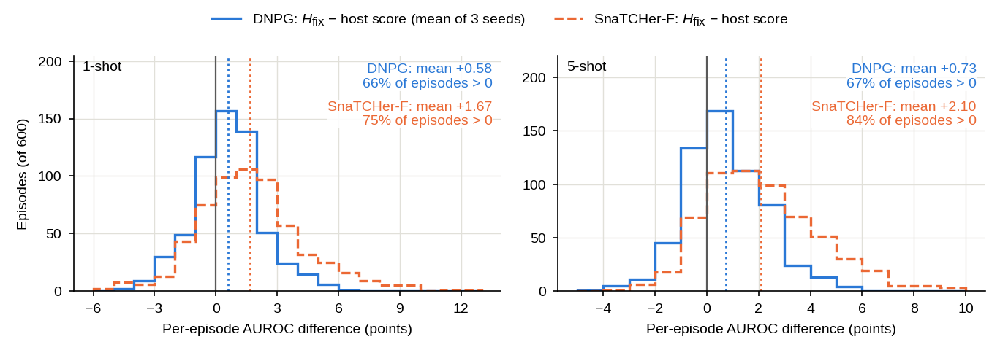
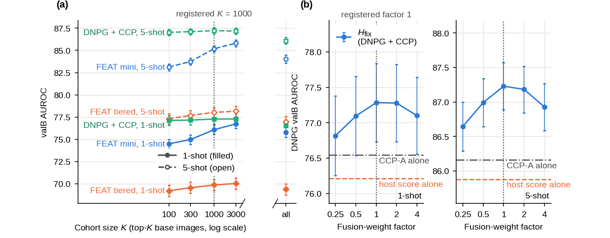
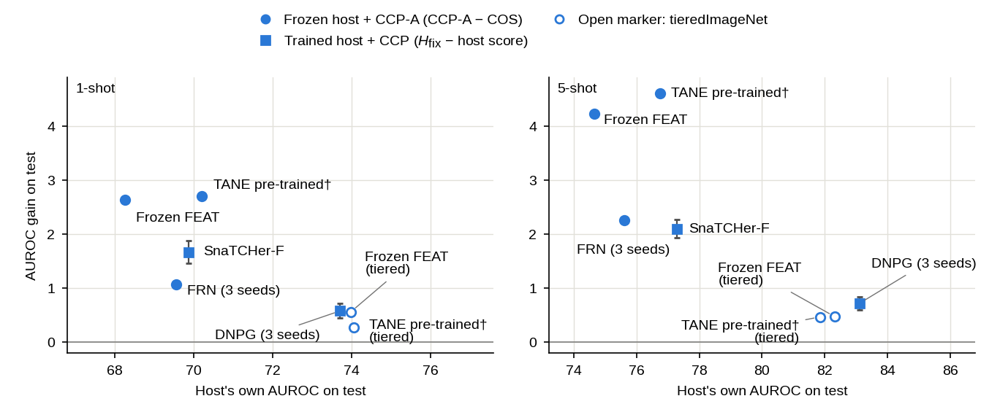

# Repository figures

Generated by `python scripts/make_figures.py episode_gains sensitivity gain_vs_host` from recorded results (former Supplementary Figures S1-S3; they are not part of the paper). The plotted data equal the recorded data in `results/recorded/figures_v0/` (`--check`).

## Per-episode test gains of fixed-weight fusion (former Supplementary Figure S1)

[PDF](episode_gains.pdf)

**Per-episode test gains of fixed-weight fusion (recorded per-episode values; no re-evaluation).** Step histograms (1-point bins) of the per-episode AUROC difference between fixed-weight fusion H_fix and the trained host's own score over the 600 mini-ImageNet test episodes per shot: DNPG (averaged over seeds 0-2 per episode; solid, blue) and SnaTCHer-F (one released model per shot; dashed, orange). Solid gray line: 0; dotted lines: means. Mean and paired 95% CI over episodes: DNPG +0.58 ± 0.13 (Wilcoxon p = 1.1e-16; 66% of episodes above 0) at 1 shot and +0.73 ± 0.12 (Wilcoxon p = 1.1e-26; 67% of episodes above 0) at 5 shots; SnaTCHer-F +1.67 ± 0.21 (Wilcoxon p = 4.0e-45; 75% of episodes above 0) and +2.10 ± 0.17 (Wilcoxon p = 1.7e-75; 84% of episodes above 0).

## Sensitivity to the cohort size and the fusion weight (former Supplementary Figure S2)

[PDF](sensitivity.pdf)

**Sensitivity to the cohort size and the fusion weight (validation only; not used for any selection).** (a) valB AUROC against the cohort size K (log scale; "all" = mean over the whole bank, after the axis break) for frozen FEAT on mini-ImageNet (CCP-A), frozen FEAT on tieredImageNet (CCP-A, BGR input) and DNPG + CCP (H_fix with its weight refitted on valA for each K, mean of seeds 0-2); 1-shot solid and filled, 5-shot dashed and open; registered K = 1000 dotted. Frozen FEAT mini-ImageNet, 1 / 5 shots: 74.49 / 83.12 (K = 100), 76.09 / 85.18 (K = 1000), 76.73 / 85.81 (K = 3000), 75.79 / 84.03 (all). (b) DNPG valB AUROC of H_fix = host score + factor · w · CCP-A against the fusion-weight factor (w fitted on valA; mean of seeds 0-2), with the host score alone (dashed) and CCP-A alone (dash-dot); registered factor 1 dotted. Paired AUROC difference from factor 1 (mean and 95% CI over the 1,000 valB episodes): 1 shot factor 0.25: -0.47 ± 0.07; factor 0.5: -0.19 ± 0.04; factor 2: -0.01 ± 0.04; factor 4: -0.18 ± 0.08; 5 shots factor 0.25: -0.58 ± 0.05; factor 0.5: -0.24 ± 0.03; factor 2: -0.05 ± 0.03; factor 4: -0.30 ± 0.06. Error bars are per-row 95% CIs over episodes (DNPG: mean of the per-seed CIs); all rows use the same episodes, so differences between rows are paired.

## Test gain against the host's own AUROC (former Supplementary Figure S3)

[PDF](gain_vs_host.pdf)

**Test gain against the host's own AUROC (recorded test numbers; no re-evaluation).** Each point is one host on the 600 fixed test episodes per shot. x: the host's own AUROC on test (COS for frozen hosts, the host score for SnaTCHer-F and DNPG). y: the AUROC gain, CCP-A − COS for frozen hosts (circles) and H_fix − host score for trained hosts (squares). Filled: mini-ImageNet; open: tieredImageNet (BGR input). FRN and DNPG are means over seeds 0-2. Error bars (trained hosts only): paired 95% CIs over the 600 episodes (DNPG: of the seed-averaged per-episode difference). Every gain is above zero (smallest +0.28). No monotone relation: Spearman ρ = 0.01 (p = 0.99) over the ten mini-ImageNet points; within a shot ρ = -0.30 (1 shot, p = 0.62) and -0.70 (5 shots, p = 0.19). † Released TANE checkpoints whose stored epochs are consistent with selection on the test split.
